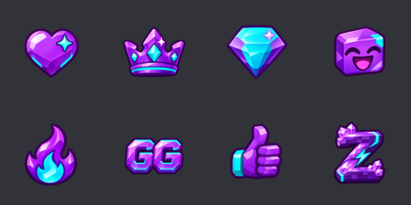

# Emojis Zyon para Discord

[Baixar o pacote completo](https://github.com/Favelado157/zyon-launcher/raw/refs/heads/discord-emojis/Emojis-Zyon.zip)

Oito emojis estáticos em roxo ametista e ciano: logo Z, coração, fogo, GG, coroa, diamante, carinha feliz e joinha.

Os PNGs individuais têm fundo transparente. A pasta **emojis** contém os arquivos de 128 × 128 pixels prontos para o Discord. A pasta **256px** contém os mesmos desenhos em resolução maior. Todos os arquivos ficam abaixo de 52 KB por PNG.

Para adicionar: **Configurações do servidor → Emojis → Enviar emoji**. Selecione os arquivos da pasta **emojis** e personalize os nomes. É necessário ter permissão para criar ou gerenciar expressões no servidor.

Veja **COMO-USAR.txt** para a lista de nomes sugeridos.
