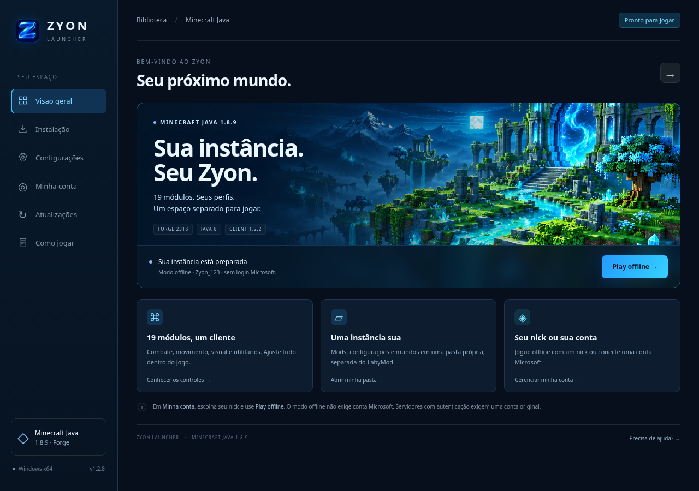
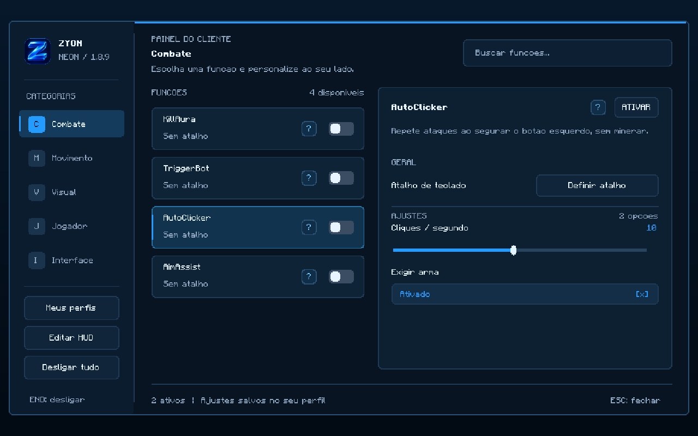
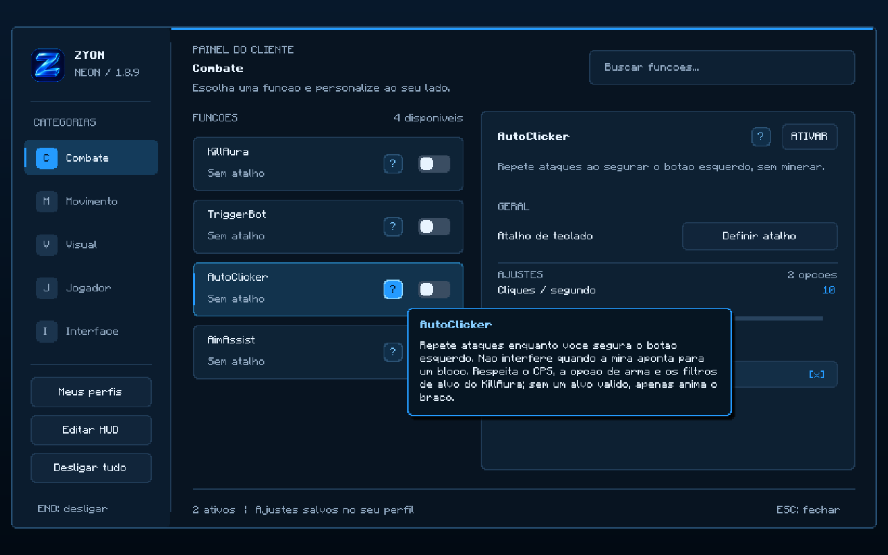

# Azul neon e novo painel do Zyon

O launcher ganhou um tema azul neon com novo ícone e arte do portal. O cliente 1.2.2 reorganiza o menu do Shift direito em categorias, lista de funções e painel de ajustes.

Passe o mouse sobre o botão **?** de uma função para ler a explicação detalhada. A ajuda também está no cabeçalho da função selecionada. Consultar ou clicar na ajuda não ativa a função.

Use a busca para encontrar funções por nome, categoria ou descrição. A roda do mouse percorre a lista ou os ajustes sob o cursor. Os botões de ativação ficam separados da ajuda. Perfis, atalhos e posições do HUD são mantidos. A atualização move o cliente anterior para `zyon-backups` e instala o JAR 1.2.2.

Validação: 50 testes do launcher e 19 do cliente; interface do launcher conferida em 1280 e 1020 pixels, menu testado no Minecraft Java 1.8.9 com Java 8, 20 botões de ajuda consultados sem alteração dos estados/atalhos/ajustes, busca, rolagem, janela menor e controles de salvar/carregar perfil verificados. O instalador final é gerado e testado pelo fluxo Windows do GitHub Actions. As capturas do launcher usam dados de demonstração; as do painel foram feitas no Minecraft.
